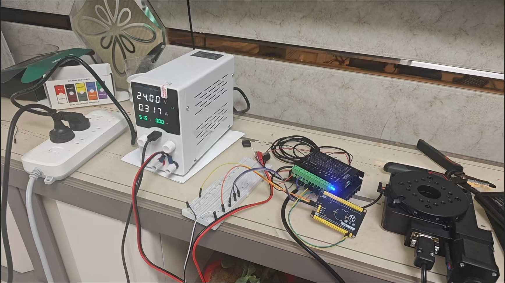
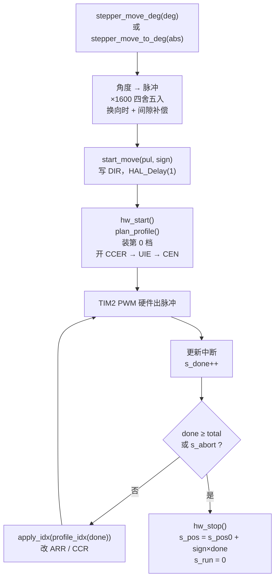

# STM32F407 步进旋转台位置控制

**YQD-42 步进驱动器 + Y200RA100 蜗轮蜗杆旋转台 —— 脉冲计数 + 分档加减速**


基于 STM32F407 的 **TIM2_CH1 硬件 PWM** 输出脉冲 + **更新中断数脉冲**，实现旋转台
**以软件坐标为基准的开环位置控制**。频率按"已发脉冲数"分 32 档等比切换，
既保证 180:1 蜗轮蜗杆重载下能可靠起动，又能在 0.32° 内爬升到 25°/s 的额定最高转速。

```
用户 API ──► 角度→脉冲换算 ──► 行程规划 ──► TIM2 PWM ──► 驱动器 ──► 转台
                    ▲                              │
                    └──── 更新中断计数/换档 ◄───────┘
```

---

## 目录

- [1. 项目简介](#1-项目简介)
- [2. 功能特性](#2-功能特性)
- [3. 硬件组成](#3-硬件组成)
- [4. 驱动原理](#4-驱动原理)
- [5. 加减速算法](#5-加减速算法)
- [6. 代码结构](#6-代码结构)
- [7. 移植与集成（CubeMX）](#7-移植与集成cubemx)
- [8. 快速开始](#8-快速开始)
- [9. 标定与调试](#9-标定与调试)
- [10. 设计取舍与已知限制](#10-设计取舍与已知限制)
- [11. 常见问题（FAQ）](#11-常见问题faq)

---

## 1. 项目简介

本驱动只包含两个文件：

| 文件 | 作用 |
| --- | --- |
| `stepper.h` | 硬件绑定说明、机械/驱动参数宏、对外 API 与返回值约定 |
| `stepper.c` | 32 档频率表、梯形/三角形速度规划、TIM2 中断服务、全部实现 |

它把一个"**步进驱动器 + 蜗轮蜗杆旋转台**"封装成 4 个动作：

```c
stepper_move_deg(90.0f);        // 相对运动 +90°（非阻塞）
stepper_wait_ms(30000);         // 等它走完（或 stepper_busy() 轮询）
stepper_move_to_deg(0.0f);      // 绝对运动回 0°
stepper_pos_deg();              // 读当前角度
```

设计目标很明确：**不占用 CPU 发脉冲、不走丢步、不靠延时凑频率**。
所有脉冲由定时器硬件产生，CPU 只在每个脉冲结束时进一次中断做"计数 + 查表换档"。

### 关键参数速查

| 项目 | 数值 | 来源 |
| --- | --- | --- |
| 电机步距角 | 1.8°（200 整步/圈） | 42 步进电机 / 转台手册 |
| 驱动器细分 | 16（3200 脉冲/圈） | YQD-42 拨码 SW1/SW2/SW3 = OFF/OFF/ON |
| 转台传动比 | 180:1（蜗轮蜗杆，自锁） | Y200RA100 手册 |
| **每度脉冲数** | **1600** | 3200 × 180 ÷ 360 |
| **单脉冲分辨率** | **0.000625°**（2.25″） | 1 ÷ 1600 |
| 转台一圈脉冲数 | 576000 | 1600 × 360 |
| 脉冲频率范围 | 1 kHz – 40 kHz（32 档） | `s_arr_tbl` |
| **角速度范围** | **0.625 – 25 °/s** | f ÷ 1600 |
| 单次运动上限 | 360° | `STEPPER_MOVE_LIMIT_DEG` |
| 加速段长度 | 512 脉冲 = 0.32°（约 139 ms） | 32 档 × 16 脉冲/档 |
| 最高速转一圈 | 14.4 s（不含加减速） | 360 ÷ 25 |
| TIM2 计数时钟 | 84 MHz（APB1 42 MHz × 2） | F407 时钟树 |

> 本仓库只包含驱动源文件（`stepper.c` / `stepper.h`），不含完整的 CubeMX 工程；
> 集成步骤见 [第 7 节](#7-移植与集成cubemx)。

---

## 2. 功能特性

- **纯硬件出脉冲**：TIM2 PWM 模式 1，占空比固定 50%，CPU 零参与波形生成；
- **按脉冲数换档的加减速**：速度曲线与"时间"解耦，总脉冲数严格守恒，不会因为换档时刻
  抖动而多走/少走一步；
- **梯形 / 三角形自适应**：行程够长就爬到 40 kHz 匀速，行程短则自动降峰、变成三角形曲线；
- **非阻塞 API**：启动即返回，`stepper_busy()` / `stepper_wait_ms()` 查询；
- **可在运动中止**：`stepper_stop()` 在下一个完整脉冲边界收尾，位置结算与实际脉冲数一致；
- **换向间隙补偿**：`STEPPER_BACKLASH_PUL` 一行参数补偿蜗轮蜗杆回程差；
- **中断里只有整数运算**：无浮点、无 `HAL_Delay`，最坏执行时间可控；
- **软件限位**：单次运动超过 ±360° 直接拒绝，保护线缆与机械；
- **停机即高阻**：关闭通道使能而不是拉低/拉高，光耦可靠关断，且不产生多余边沿。

---

## 3. 硬件组成

### 3.1 物料清单

| 部件 | 型号 | 关键参数 |
| --- | --- | --- |
| 主控 | STM32F407 开发板 | SYSCLK 168 MHz，APB1 42 MHz，TIM2 84 MHz |
| 步进驱动器 | **YQD-42** | 两相混合式，9–40 VDC，最大 4.0 A，最高 32 细分，内置过热/过流/过压保护 |
| 步进电机 | 42 两相混合式 | 步距角 1.8°，转台自带（工作电流 1.7 A） |
| 旋转台 | **Y200RA100** | 台面 Φ100 mm，传动比 180:1，蜗轮蜗杆自锁，中心承载 45 kg，自重 1.7 kg，最大速度 25°/s |
| 直流电源 | 24 V | 建议 ≥ 2 A，输出端并 100–470 µF 电解电容 |
| 信号电源 | 5 V（共阳） | 与驱动器 PUL+/DIR+ 共用 |

### 3.2 接线

本工程使用 **共阳极接法**：驱动器的 `PUL+` / `DIR+` 接 +5 V，MCU 的引脚接
`PUL-` / `DIR-`，**引脚拉低时光耦导通**（低电平有效）。

```
                       YQD-42 驱动器
                    ┌────────────────┐
   5V ──────────────┤ PUL+           │
   PA0 (TIM2_CH1) ──┤ PUL-           │
   5V ──────────────┤ DIR+           │        A+ ──┐
   PA1 (GPIO) ──────┤ DIR-           │        A- ──┤  42 步进电机
   (悬空) ──────────┤ ENA+ / ENA-    │        B+ ──┤  (1.8°, 两相)
   24V+ ────────────┤ VCC            │        B- ──┘
   24V- ────────────┤ GND ───────────┼─────┐
                    └────────────────┘     │
                                           ├── STM32 的 GND（必须共地！）
                                           └── 5V 电源的 GND
```

| STM32F407 | 方向 | 驱动器端子 | 说明 |
| --- | --- | --- | --- |
| PA0 | 输出 | `PUL-` | TIM2_CH1（AF1），PWM 脉冲，**低电平点亮光耦** |
| PA1 | 输出 | `DIR-` | 普通 GPIO，电平决定转向；CubeMX 中命名为 `DIR` |
| 5 V | 电源 | `PUL+`、`DIR+` | 共阳端，两个 `+` 接在一起 |
| — | — | `ENA+`、`ENA-` | **悬空**（手册：光耦导通 = 脱机，悬空最安全，驱动器常使能） |
| 24 V+ | 电源 | `VCC` | 9–40 VDC |
| 24 V− | 电源 | `GND` | 必须与 MCU 共地，否则脉冲完全无效 |

> `PA0` 空闲时被置为高阻（`CC1E = 0`），光耦无电流，等于"没有脉冲"；
> 这比把引脚拉高/拉低更安全 —— 不会因为电平极性理解错而让驱动器一直收到直流电平。

### 3.3 驱动器拨码设置

YQD-42 的 6 位拨码分两组：SW1–SW3 设细分，SW4–SW6 设电流。

**细分（本工程必须为 16）**

| 细分 | 脉冲/圈 | SW1 | SW2 | SW3 |
| --- | --- | --- | --- | --- |
| 8 | 1600 | OFF | ON | OFF |
| **16** | **3200** | **OFF** | **OFF** | **ON** |
| 32 | 4000 | OFF | OFF | OFF |

**电流（转台电机额定 1.7 A，建议从 1.5 A 档起步）**

| 平均电流 | 峰值电流 | SW4 | SW5 | SW6 |
| --- | --- | --- | --- | --- |
| 1.0 A | 1.2 A | ON | OFF | ON |
| **1.5 A** | **1.7 A** | **ON** | **ON** | **OFF** |
| 2.0 A | 2.2 A | ON | OFF | OFF |

> 表中"1.5 A"是**建议值**：先按额定电流跑，若带 45 kg 负载起动无力再升到 2.0 A 档，
> 以连续运行 30 min 后电机/驱动器外壳不烫手为准。细分必须与
> `stepper.h` 里的 `STEPPER_MICROSTEP` 保持一致，否则角度全部按比例错。

### 3.4 实物图



### 3.4 电气注意事项

1. **必须共地**：24 V 电源负极、5 V 电源负极、STM32 的 GND 三者连在一起。
   只接 PUL/DIR 不共地是最常见的"程序没问题但电机不动"。
2. **电平匹配**：STM32F407 的 PA0/PA1 **不是 5 V 容忍（FT）引脚**。5 V 共阳时，
   光耦截止期间 `PUL-`/`DIR-` 会被 5 V 经限流电阻上拉，超过引脚绝对最大额定
   （VDD + 0.3 V ≈ 3.6 V），电流会经 ESD 保护二极管灌进 3.3 V 电源。
   台架短期验证通常能工作，长期建议：
   - **推荐**：用 NPN 三极管 / N-MOS / ULN2003 做一级开漏缓冲，MCU 只驱动三极管，
     5 V 回路与 MCU 隔离；
   - 或改用 3.3 V 共阳（驱动器标称 5–24 V，3.3 V 属于欠压使用，需实测光耦能否可靠翻转）。
   若发现"有脉冲但电机不按脉冲走"，优先怀疑高电平没能把光耦完全关断。
3. **不要带电插拔电机线**：驱动器上电时断开 A/B 相可能因反电动势损坏功率级。
4. **电源余量**：24 V 建议 ≥ 2 A，并在驱动器 VCC/GND 端就近并 100–470 µF 电解电容，
   吸收换向时的电流突变。
5. **ENA 悬空 = 常使能**：电机始终有保持力矩（蜗轮蜗杆本身也自锁）。
   若需要软件脱机，必须另接一个 GPIO 到 `ENA-`，注意 **ENA 导通（低电平）= 脱机**，
   上电默认应为高/高阻。

---

## 4. 驱动原理

### 4.1 脉冲 + 方向（Pulse / Direction）

YQD-42 是"脉冲+方向"型驱动器：

- **每一个脉冲**（内部光耦完成一次"导通→截止"）电机走 **一个细分步**；
- **DIR 电平** 决定这一串脉冲往哪个方向走，方向信号必须先于第一个脉冲
  **至少 5 µs** 建立（本代码用 `HAL_Delay(1)` = 1 ms，余量 200 倍）；
- 脉冲宽度必须 **> 1.2 µs**。本工程最窄的半个周期是 40 kHz 时的 **12.5 µs**，
  有 10 倍余量；
- 脉冲频率决定转速，**脉冲总数**决定角度。角度与脉冲数是严格一一映射，
  所以只要不丢步，开环位置就是精确的。

> 共阳接法下，"驱动器眼里的一个脉冲" = PA0 的一个完整 PWM 周期
> （高 50% + 低 50%），光耦在 PA0 为低的那一半导通。
> 频率、数量都不变，只是极性反相，因此不影响定位。

### 4.2 细分与角度换算

```
电机整步        1.8°  ->  360 / 1.8 = 200 整步/圈
16 细分               ->  200 × 16  = 3200 脉冲/圈（电机轴）
转台传动比 180:1      ->  3200 × 180 = 576000 脉冲/圈（转台）
每度脉冲数            ->  576000 / 360 = 1600 脉冲/°
单脉冲角度            ->  1 / 1600 = 0.000625° = 2.25″
```

代码里就是这一行：

```c
#define STEPPER_PUL_PER_DEG  (STEPPER_MICROSTEP * 200u * 180u / 360u)  /* = 1600 */
```

**改细分时只改 `STEPPER_MICROSTEP`；换转台时改 `STEPPER_PUL_PER_DEG` 里的传动比 180**，
其余逻辑不用动（频率表与分辨率无关，因为频率表的单位是"脉冲/秒"）。

### 4.3 速度 ↔ 频率

因为 1° = 1600 脉冲：

```
角速度 v(°/s) = 脉冲频率 f(Hz) / 1600
脉冲频率 f(Hz) = 1600 × v(°/s)
```

| 档位 | 频率 | 周期 | 角速度 | 走 1° 需要 |
| --- | --- | --- | --- | --- |
| 0（起动） | 1 kHz | 1 ms | 0.625 °/s | 1.6 s |
| 16（中速） | 6.71 kHz | 149 µs | 4.20 °/s | 238 ms |
| 31（最高） | 40 kHz | 25 µs | **25 °/s** | 40 ms |

最高档 40 kHz 恰好对应转台手册的 **25°/s** 最大速度，再高没有意义（会堵转/丢步）。

---

## 5. 加减速算法

### 5.1 为什么必须加减速

Y200RA100 是 **180:1 蜗轮蜗杆** 传动，自锁、静摩擦力矩大。如果一上电就给 40 kHz：

- 转子跟不上旋转磁场 → **堵转/啸叫**，一步都不走；
- 即使勉强起动，蜗杆副的冲击也会让末端抖动，甚至丢步。

所以必须"**低频起动 → 逐档爬频 → 高速匀速 → 逐档降频 → 低频停止**"。
减速同样重要：25°/s 时转台带着 45 kg 负载的惯量，直接断脉冲会过冲、定位不准。

### 5.2 32 档等比频率表

32 个档位的频率按等比数列从 1 kHz 排到 40 kHz：

```
f(i) = 1000 × 40^(i/31)        i = 0 … 31，公比 = 40^(1/31) ≈ 1.1264
ARR(i) = round(84_000_000 / f(i)) - 1     // 周期 = (ARR+1) 个 84MHz 计数
CCR(i) = (ARR(i) + 1) / 2                 // 固定 50% 占空比
```

用等比而不是等差，是因为**听觉和转矩的感受都接近对数**：低频段步子细（0.625→0.704→0.793
°/s），高频段步子大（22.2→25 °/s），既不会在起动时"跳档"，也不会在高速段浪费档位。

| 档 | ARR | 频率 (Hz) | 周期 | 角速度 (°/s) |
| ---: | ---: | ---: | ---: | ---: |
| 0 | 83999 | 1,000 | 1.00 ms | 0.625 |
| 1 | 74575 | 1,126 | 888 µs | 0.704 |
| 2 | 66209 | 1,269 | 788 µs | 0.793 |
| 3 | 58781 | 1,429 | 700 µs | 0.893 |
| 4 | 52186 | 1,610 | 621 µs | 1.006 |
| 5 | 46331 | 1,813 | 552 µs | 1.133 |
| 6 | 41133 | 2,042 | 490 µs | 1.276 |
| 7 | 36518 | 2,300 | 435 µs | 1.438 |
| 8 | 32421 | 2,591 | 386 µs | 1.619 |
| 9 | 28784 | 2,918 | 343 µs | 1.824 |
| 10 | 25555 | 3,287 | 304 µs | 2.054 |
| 11 | 22688 | 3,702 | 270 µs | 2.314 |
| 12 | 20142 | 4,170 | 240 µs | 2.606 |
| 13 | 17882 | 4,697 | 213 µs | 2.936 |
| 14 | 15876 | 5,291 | 189 µs | 3.307 |
| 15 | 14095 | 5,959 | 168 µs | 3.724 |
| 16 | 12513 | 6,712 | 149 µs | 4.195 |
| 17 | 11109 | 7,561 | 132 µs | 4.725 |
| 18 | 9863 | 8,516 | 117 µs | 5.322 |
| 19 | 8756 | 9,592 | 104 µs | 5.995 |
| 20 | 7774 | 10,804 | 93 µs | 6.752 |
| 21 | 6902 | 12,169 | 82 µs | 7.605 |
| 22 | 6127 | 13,708 | 73 µs | 8.567 |
| 23 | 5440 | 15,438 | 65 µs | 9.649 |
| 24 | 4829 | 17,391 | 58 µs | 10.870 |
| 25 | 4287 | 19,590 | 51 µs | 12.243 |
| 26 | 3806 | 22,065 | 45 µs | 13.790 |
| 27 | 3379 | 24,852 | 40 µs | 15.533 |
| 28 | 3000 | 27,991 | 36 µs | 17.494 |
| 29 | 2663 | 31,532 | 32 µs | 19.707 |
| 30 | 2364 | 35,518 | 28 µs | 22.199 |
| 31 | 2099 | 40,000 | 25 µs | **25.000** |

> 最高档的半个周期 12.5 µs，仍远大于 YQD-42 要求的 1.2 µs 最小脉宽。

### 5.3 按"脉冲数"换档，而不是按"时间"

每一档固定持续 **16 个脉冲**（`STEPPER_PPS`），由中断里的 `s_done` 决定下一拍用哪一档：

```c
done = ++s_done;
apply_idx(profile_idx(done));    /* 查表决定下一个脉冲的频率 */
```

**为什么不用定时器按时间切换？**

| 方案 | 问题 |
| --- | --- |
| 按时间换档（每 5 ms 升一档） | 换档时刻有中断延迟/抖动，某一档可能多发或少发若干脉冲，最终**角度有累积误差** |
| **按脉冲数换档（本方案）** | 换档只发生在脉冲边界，**总脉冲数恒定守恒**，走多少脉冲就是多少角度 |

本方案还有一个好处：换档点总是落在"一个完整脉冲结束"的更新事件上，
`ARR` 配了预装载（ARPE），新周期从下一拍才生效，不会产生畸形脉宽。

### 5.4 梯形 / 三角形自适应规划

`plan_profile()` 在每次启动前根据总脉冲数决定"能爬多高"：

```c
if (total >= 2 * (TOP_IDX + 1) * PPS) {   /* 1024 个脉冲 = 0.64° */
    a = TOP_IDX + 1;                      /* 加、减速各 512 脉冲，爬满 32 档 */
    s_peak = TOP_IDX;
} else {
    a = total / (2 * PPS);                /* 行程短：只能爬到一半就减速 */
    s_peak = (a > 0) ? (a - 1) : 0;
}
s_acc_len = a * PPS;
```

`profile_idx()` 负责给出"第 done 个脉冲走完之后，下一拍用哪一档"：

```c
if (done < s_acc_len) {
    i = done / STEPPER_PPS;                       /* 加速段：正向数 */
} else if (done >= s_total - s_acc_len) {
    i = (s_total - done - 1) / STEPPER_PPS;       /* 减速段：按剩余脉冲镜像 */
} else {
    i = s_peak;                                   /* 匀速段 */
}
/* 限幅到 [0, s_peak] */
```

- **加速段**：`done / 16` → 0,0,…,1,1,…,31；
- **匀速段**：锁在 `s_peak`；
- **减速段**：用 `s_total - done - 1` 做镜像，保证和加速段**严格对称**，
  最后一个脉冲的频率一定是 1 kHz（档 0）；
- 减速公式里的 `-1` 是因为它算的是"**下一个**脉冲"的档位，
  不减 1 会让减速段比加速段少一个脉冲、结尾多跳一档。

**不同行程的实际规划结果**（理论计算值）：

| 目标角度 | 总脉冲 | 加速段 | 峰值档 | 峰值速度 | 预计耗时 |
| ---: | ---: | ---: | ---: | ---: | ---: |
| 0.01° | 16 | 0 | 0 | 0.63 °/s | 16 ms |
| 0.1° | 160 | 80 | 4 | 1.01 °/s | 128 ms |
| 1° | 1600 | 512 | 31 | 25.0 °/s | 293 ms |
| 10° | 16000 | 512 | 31 | 25.0 °/s | 653 ms |
| 90° | 144000 | 512 | 31 | 25.0 °/s | 3.85 s |
| 360° | 576000 | 512 | 31 | 25.0 °/s | 14.65 s |

可以看到：行程小于 **0.64°（1024 脉冲）** 时根本爬不到最高档；即使走 1°，
1600 个脉冲里也有 1024 个（约 279 ms）花在加减速上，匀速段只剩 576 个脉冲（14 ms）。
这是 180:1 蜗轮蜗杆的物理限制，不是代码问题；要更快只能减小 `STEPPER_PPS`
（加速更陡）或减少档数。

### 5.5 时序

```
一个 PWM 周期 = 一个脉冲 = 一个细分步 = 0.000625°

PA0        ┌────────┐         ┌────────┐         ┌────────┐
        ───┘        └─────────┘        └─────────┘        └───
           ↑        ↑         ↑        ↑
        更新事件  CCR 匹配   更新事件  CCR 匹配
        (CNT=0)  (CNT=CCR)  (CNT=0)  (CNT=CCR)
           │                         │
           └── ISR：s_done++ ────────┘   ← 每个周期只进一次中断
               换档 / 判断是否到量

驱动器光耦   ▔▔▔▔▔▔▔▔▁▁▁▁▁▁▁▁▁▁▔▔▔▔▔▔▔▔▁▁▁▁▁▁▁▁▁▁
（低电平导通）         ↑ 计 1 步          ↑ 计 1 步
```

DIR 与第一个脉冲的关系（`start_move()` 里用 `HAL_Delay(1)` 保证）：

```
DIR   ──────────┬──────────────────────────────────
                │<---- ≥ 5 µs（实际 1 ms）---->│
PUL   __________/‾‾‾‾\____/‾‾‾‾\____/‾‾‾‾\______
```

### 5.6 换细分 / 换时钟后如何重新生成表

改 `STEPPER_TIM_CLK_HZ`、`STEPPER_PROF_N`、起始/最高频率后，用这段脚本重新生成
`s_arr_tbl`（默认参数会输出与代码中**完全一致**的 32 个数）：

```python
TIM_CLK = 84_000_000          # TIM2 计数时钟 = APB1 × 2
N       = 32                  # 档数 STEPPER_PROF_N
F_MIN   = 1_000               # 起动频率 (Hz)
F_MAX   = 40_000              # 最高频率 (Hz)

arr = [round(TIM_CLK / (F_MIN * (F_MAX / F_MIN) ** (i / (N - 1)))) - 1
       for i in range(N)]

for i in range(0, N, 8):
    print("  " + ", ".join(f"{a}u" for a in arr[i:i + 8]) + ",")
```

输出：

```
  83999u, 74575u, 66209u, 58781u, 52186u, 46331u, 41133u, 36518u,
  32421u, 28784u, 25555u, 22688u, 20142u, 17882u, 15876u, 14095u,
  12513u, 11109u, 9863u, 8756u, 7774u, 6902u, 6127u, 5440u,
   4829u, 4287u, 3806u, 3379u, 3000u, 2663u, 2364u, 2099u
```

> 注意：`STEPPER_PPS` 必须是 2 的幂（代码用 `/` 让编译器优化成移位）；
> 改完表后 `STEPPER_TOP_IDX` 也要同步改成"允许使用的最高档"。

---

## 6. 代码结构

### 6.1 文件与依赖

```
stepper.h  ── 参数宏（细分/传动比/间隙/限位）+ API 声明 + 使用说明
    │
    ├── main.h   DIR_Pin / DIR_GPIO_Port（CubeMX 生成的引脚标签）
    └── tim.h    htim2（CubeMX 生成的定时器句柄）

stepper.c  ── 32 档 ARR 表、速度规划、GPIO/TIM 操作、中断服务、API 实现
```

依赖只有 STM32Cube HAL 的 `main.h` / `tim.h`，不依赖 RTOS、不依赖 `printf`、
不使用动态内存，可以直接拷进任意 STM32F4 CubeMX 工程。

### 6.2 数据流



### 6.3 内部状态

| 变量 | 类型 | 含义 | 谁写 |
| --- | --- | --- | --- |
| `s_run` | `volatile uint8_t` | 1 = 运动中 | `hw_start` / ISR / `stepper_stop` |
| `s_abort` | `volatile uint8_t` | 1 = 请求在下一个脉冲边界停止 | `stepper_stop` / `hw_stop` |
| `s_done` | `volatile int32_t` | 本段已完整发出的脉冲数 | ISR |
| `s_total` | `volatile int32_t` | 本段目标脉冲数 | `start_move` / `hw_start` |
| `s_acc_len` | `int32_t` | 加速段脉冲数（减速段与之对称） | `plan_profile` |
| `s_peak` | `int32_t` | 本段允许的最高档 | `plan_profile` |
| `s_idx` | `volatile uint32_t` | 当前档位 | `apply_idx` |
| `s_sign` | `int32_t` | 本段方向 +1 / −1 | `start_move` |
| `s_last_sign` | `int32_t` | 上一段方向，0 = 上电后未动过 | `start_move` |
| `s_pos` | `int32_t` | 已确认位置（脉冲） | ISR 收尾 / `stepper_set_zero` |
| `s_pos0` | `int32_t` | 本段起始位置（脉冲） | `start_move` |
| `s_ready` | `uint8_t` | 1 = 已初始化 | `stepper_init` |

设计要点：

- **`s_pos` 只在"一段走完"时更新**，运动过程中读位置用
  `s_pos + s_sign * s_done` 现算（见 `stepper_pos_deg()`），
  避免在 32 位变量上做"读—改—写"的竞争；
- `s_done` 由 ISR 单调递增，主循环只读，天然安全；
- 在 ISR 与主循环之间共享的 `s_run` / `s_abort` / `s_done` / `s_total` / `s_idx`
  都声明为 `volatile`，编译器不会把它们缓存进寄存器；
- `s_pos` / `s_pos0` / `s_sign` 没有加 `volatile`：它们由主循环在启动前写、
  ISR 只读或在本段收尾时写，Cortex-M4 的 32 位对齐访问本身是原子的。
  如果开启 LTO 或希望加一道编译器屏障，建议把 `s_pos` 也声明为 `volatile`。

### 6.4 函数逐个说明

#### `ccr_of(arr)`

```c
static inline uint32_t ccr_of(uint32_t arr)
{
  return (arr + 1u) >> 1;      /* 50% 占空比 */
}
```

PWM 模式 1 中，`CNT < CCR` 输出有效电平。周期是 `ARR+1` 个计数，
所以 `CCR = (ARR+1)/2` 就是 50% 占空比（`ARR+1` 为奇数时高/低相差 1 个计数，
约 11.9 ns，可忽略）。50% 的好处是高低电平均为半周期，
**最窄脉宽自动等于半个周期**，40 kHz 时仍有 12.5 µs。

#### `apply_idx(i)` —— 装载某一档

```c
static void apply_idx(uint32_t i)
{
  uint32_t arr;
  if (i >= STEPPER_PROF_N) { i = STEPPER_PROF_N - 1u; }
  s_idx = i;
  arr   = s_arr_tbl[i];
  __HAL_TIM_SET_AUTORELOAD(&htim2, arr);
  __HAL_TIM_SET_COMPARE(&htim2, TIM_CHANNEL_1, ccr_of(arr));
}
```

- 写入 `ARR` 是写**预装载寄存器**，下一个更新事件才生效，所以当前这个脉冲
  一定是完整、不变形的；
- 写入 `CCR`：若 `OC1PE = 1`（推荐，CubeMX 里勾选 Output Compare Preload），
  与 `ARR` 一样在下一个更新事件生效；若 `OC1PE = 0` 则立即生效。
  因为占空比恒为 50%，两种情况都不会丢脉冲，也不会产生窄于半周期的毛刺；
- 档位索引做了上溢保护，`s_peak` 的限幅在 `profile_idx()` 里做。

#### `profile_idx(done)` —— 速度曲线

见 [5.4](#54-梯形--三角形自适应规划)。核心是"加速按 `done` 数、减速按剩余脉冲镜像"，
保证加速段与减速段脉冲数严格相等。

#### `plan_profile(total)` —— 行程规划

见 [5.4](#54-梯形--三角形自适应规划)。`total` 小于 1024 脉冲（0.64°）时
自动降峰，形成三角形曲线；小于 32 脉冲（0.02°）时 `a = 0`、`peak = 0`，
整段都用 1 kHz 走完（避免"还没加速就结束"）。

#### `hw_stop()` —— 停机

```c
static void hw_stop(void)
{
  CLEAR_BIT(htim2.Instance->CR1,  TIM_CR1_CEN);         /* 1. 停计数器 */
  CLEAR_BIT(htim2.Instance->DIER, TIM_DIER_UIE);        /* 2. 关更新中断 */
  CLEAR_BIT(htim2.Instance->CCER, TIM_CCER_CC1E_Msk);   /* 3. 引脚高阻 */
  s_abort = 0u;
}
```

顺序很重要：**先停计数器 → 再关中断 → 最后释放引脚**。
这样停机后不会再有新的更新事件，也不会因为残留的 `UIF` 又进一次中断把
`s_done` 多加 1。`CC1E = 0` 让 PA0 变成高阻，共阳接法下光耦彻底关断，
既不会输出半个脉冲，也不会给驱动器一个"常低"的有效电平。

#### `hw_start()` —— 启动

```c
static void hw_start(void)
{
  s_abort = 0u;
  s_done = 0;
  plan_profile(s_total);          /* 根据总脉冲数决定加速段与峰值档 */
  apply_idx(0u);                  /* 一定从 1 kHz 起步 */

  CLEAR_BIT(htim2.Instance->CR1, TIM_CR1_CEN);
  __HAL_TIM_SET_COUNTER(&htim2, 0u);
  htim2.Instance->EGR = TIM_EGR_UG;                  /* 立即装载 ARR/CCR 影子寄存器 */
  __HAL_TIM_CLEAR_FLAG(&htim2, TIM_FLAG_UPDATE);     /* UG 会置 UIF，必须清 */
  NVIC_ClearPendingIRQ(TIM2_IRQn);

  s_run = 1u;
  SET_BIT(htim2.Instance->CCER, TIM_CCER_CC1E_Msk);  /* 使能输出 */
  SET_BIT(htim2.Instance->DIER, TIM_DIER_UIE);       /* 使能更新中断 */
  SET_BIT(htim2.Instance->CR1,  TIM_CR1_CEN);        /* 启动计数 */
}
```

几个容易踩的点：

1. `EGR = UG` 会把预装载的 `ARR/CCR` 立刻搬进工作寄存器，同时把 `CNT` 清零。
   **不写这一句，第一拍的 `ARR` 可能还是上一段的旧值**；
2. `UG` 会顺带把 `UIF` 置 1。如果不清，接着使能 `UIE` 会**立刻进一次中断**，
   `s_done` 凭空 +1 → 少发一个脉冲、位置差一步。所以必须
   `__HAL_TIM_CLEAR_FLAG(TIM_FLAG_UPDATE)`；
3. 同理要清 NVIC 的 pending 位，防止之前残留的请求在使能中断后立刻触发；
4. 使能顺序 `CCER → UIE → CEN`：先让引脚处于正确的空闲电平，再开中断，
   最后才让计数器跑，避免"第一个脉冲还没准备好就进中断"。

#### `HAL_TIM_PeriodElapsedCallback()` —— 中断服务

```c
void HAL_TIM_PeriodElapsedCallback(TIM_HandleTypeDef *htim)
{
  int32_t done;

  if (htim->Instance != TIM2) { return; }
  if (s_run == 0u)            { return; }

  done = ++s_done;
  if (s_abort != 0u || done >= s_total) {
    hw_stop();
    s_pos = s_pos0 + s_sign * done;   /* 按实际完整脉冲数结算 */
    s_run = 0u;
    return;
  }
  apply_idx(profile_idx(done));
}
```

- 一次更新事件 = 一个完整 PWM 周期 = 驱动器收到一个脉冲，所以这里
  `s_done` 加 1；
- **先加再判断**：`done >= s_total` 成立时，第 `total` 个脉冲已经完整输出，
  此时停机位置正好；
- 停机结算用 `done` 而不是 `s_total`：如果是被 `stepper_stop()` 中途叫停，
  位置只按真实发出的脉冲数记，软件坐标与机械位置保持一致；
- 整个 ISR 只有整数加减、查表和两次寄存器写，40 kHz 下每 25 µs 进一次，
  在 168 MHz 上大约占用 3–5% CPU；
- 该函数覆盖了 HAL 的 `__weak` 版本，**全工程只能有这一个定义**。
  如果工程里还有别的定时器也用 `HAL_TIM_PeriodElapsedCallback`，要在这里加
  `else if` 分支，不能重复定义。

#### `stepper_init()`

```c
hw_stop();                                    /* 上电先保证没有脉冲 */
HAL_GPIO_WritePin(DIR_GPIO_Port, DIR_Pin, STEPPER_DIR_CW);
apply_idx(0u);
__HAL_TIM_SET_COUNTER(&htim2, 0u);
htim2.Instance->EGR = TIM_EGR_UG;
__HAL_TIM_CLEAR_FLAG(&htim2, TIM_FLAG_UPDATE);

NVIC_SetPriority(TIM2_IRQn, 1u);
NVIC_ClearPendingIRQ(TIM2_IRQn);
NVIC_EnableIRQ(TIM2_IRQn);
...
s_ready = 1u;
```

- 先检查 `htim2.Instance != TIM2`，防止 `MX_TIM2_Init()` 还没跑就调用；
- 上电先把 DIR 置为默认方向、把 PA0 置为高阻，**绝不会上电自转**；
- 中断优先级设为 1：高于普通任务，又低于内核异常；如果你的系统里有更严格的
  实时任务，可以再调；
- `s_ready` 是"初始化完成"的唯一判据，所有 API 在它为 0 时返回 `-3`。

#### `start_move(pul, sign)` / `stepper_move_deg()` / `stepper_move_to_deg()`

```c
HAL_GPIO_WritePin(DIR_GPIO_Port, DIR_Pin,
                  (sign > 0) ? STEPPER_DIR_CW : STEPPER_DIR_CCW);
HAL_Delay(1u);        /* 手册要求 DIR 先于 PUL ≥5µs，这里给 1ms */
```

- `HAL_Delay(1)` 是**阻塞**的，每次启动多花 1 ms；如果节拍很紧，可以换成
  DWT 延时或 `__NOP()` 循环，但不能低于 5 µs；
- 角度转脉冲：`pul = (int32_t)(mag * 1600 + 0.5f)`，`+0.5f` 是四舍五入；
- 小于半个脉冲（< 0.0003125°）的请求直接返回 0，不启动，也不改变 `s_last_sign`；
- **换向补偿**：`s_last_sign != sign` 时给 `pul` 加上 `STEPPER_BACKLASH_PUL`；
- `stepper_move_to_deg()` 只是 `stepper_move_deg(abs - pos)` 的薄封装，
  同样受 `STEPPER_MOVE_LIMIT_DEG` 限制（限制的是**本段行程**）；
- `stepper_move_to_deg()` 内部先查忙，再调 `stepper_move_deg()`，后者会再查一次，
  两次检查之间不会有新的运动插入（单线程主循环）。

#### `stepper_stop()`

```c
s_abort = 1u;                 /* 让 ISR 在下一个完整脉冲处收尾 */
while (s_run != 0u) {
  if ((HAL_GetTick() - t0) > 5u) {   /* 中断被关时的兜底 */
    ...
  }
}
```

不在半截脉冲上硬掐：置标志后由 ISR 在脉冲边界停机，位置结算和实际脉冲数一致，
也不会给驱动器一个宽度不足的脉冲。最长等待 = 当前档一个周期（最慢 1 ms），
兜底 5 ms。**不要在高优先级中断里调用它**（会等不到 TIM2 中断）。

> 兜底分支会临时关 TIM2 中断、直接 `hw_stop()`，再按 `s_done` 结算位置。
> 这条路径只在"有代码长时间关全局中断"时才会走到，正常使用不会触发。

#### 查询类 API

| 函数 | 说明 |
| --- | --- |
| `stepper_busy()` | 返回 `s_run`，1 = 正在走 |
| `stepper_wait_ms(ms)` | 轮询等待，0 = 到位，−1 = 超时（**超时后运动仍在继续**） |
| `stepper_pos_deg()` | 返回 `(s_pos + s_sign*s_done)/1600`，运动中也能读 |
| `stepper_set_zero()` | 仅在停止时有效，纯软件置零，不发脉冲 |
| `stepper_get_freq_hz()` | 返回当前/最近档位频率，调试用 |

### 6.5 API 与返回值速查

```c
void    stepper_init(void);                  /* MX_TIM2_Init() 之后调用 */
int     stepper_move_deg(float deg);         /* 相对运动，非阻塞 */
int     stepper_move_to_deg(float abs_deg);  /* 绝对运动，非阻塞 */
uint8_t stepper_busy(void);                  /* 1 = 运动中 */
int     stepper_wait_ms(uint32_t timeout_ms);/* 等待本次运动结束 */
void    stepper_stop(void);                  /* 在完整脉冲边界停止 */
float   stepper_pos_deg(void);               /* 当前角度（相对上电零点） */
int     stepper_set_zero(void);              /* 当前位置定义为 0° */
float   stepper_get_freq_hz(void);           /* 当前档位频率，调试用 */
```

| 返回值 | 含义 | 出现在 |
| ---: | --- | --- |
| `0` | 成功 / 已到位 | 全部 |
| `-1` | 正在运动中，请求被忽略；或等待超时 | `move_*` / `wait_ms` / `set_zero` |
| `-2` | 参数非法（NaN，或角度超过 ±360°） | `move_*` |
| `-3` | 未初始化 / TIM2 未配置 | `move_*` |

**最小可分辨动作**：`1/1600° = 0.000625°`。请求角度小于半个脉冲时
`stepper_move_deg()` 返回 0 但不产生任何动作，这是正常行为，不是错误。

### 6.6 资源占用

| 项目 | 占用 |
| --- | --- |
| Flash | `s_arr_tbl` 128 B + 代码约 1–2 KB（取决于优化等级） |
| RAM | 约 50 B 静态变量，无堆 |
| 中断 | 1 个（TIM2_IRQn，优先级 1） |
| CPU | 最高 40 kHz × 每次约 1 µs ≈ **4% @168 MHz**（粗估，含 HAL 入口） |
| 外设 | TIM2_CH1（PA0）、一个 GPIO（PA1） |

---

## 7. 移植与集成（CubeMX）

### 7.1 CubeMX 配置清单

| 位置 | 配置项 | 值 |
| --- | --- | --- |
| RCC | HSE / PLL | 按板子晶振配置，目标 **SYSCLK = 168 MHz** |
| Clock | APB1 Prescaler | `/4` → 42 MHz |
| Clock | APB1 Timer Clocks | 自动 = **84 MHz**（`RCC.APB1TimFreq_Value`） |
| SYS | Debug | Serial Wire |
| SYS | Timebase | SysTick（`HAL_Delay` / `HAL_GetTick` 依赖它） |
| PA0 | 复用功能 | **TIM2_CH1**（AF1），Push-Pull，No pull，Very High speed |
| PA1 | GPIO_Output | 标签 **`DIR`**，Push-Pull，No pull，Low speed（初始电平无所谓，`stepper_init()` 会先置 CW） |
| TIM2 | Clock Source | Internal Clock |
| TIM2 | Prescaler | **0**（计数时钟 = 84 MHz） |
| TIM2 | Counter Mode | Up |
| TIM2 | Counter Period (ARR) | 83999（随便填，运行时会覆盖） |
| TIM2 | auto-reload preload | **Enable**（必须，换档才不会产生畸形脉冲） |
| TIM2 CH1 | Mode | **PWM Generation CH1**，PWM Mode 1 |
| TIM2 CH1 | Pulse (CCR) | 42000（随便填，运行时会覆盖） |
| TIM2 CH1 | Output compare preload | Enable |
| TIM2 CH1 | CH Polarity | High |
| NVIC | TIM2 global interrupt | **Enabled**（必须） |

> 不要开 One Pulse Mode、不要用 Slave/Trigger 模式，本驱动自己管理 `CEN` / `CCER` / `DIER`。

### 7.2 生成代码后必须检查的 3 件事

1. **`Core/Src/stm32f4xx_it.c` 里有 TIM2 中断入口**

   ```c
   void TIM2_IRQHandler(void)
   {
     HAL_TIM_IRQHandler(&htim2);
   }
   ```

   CubeMX 在 NVIC 里勾选 "TIM2 global interrupt" 后会自动生成。
   **没有它 → `s_done` 永远不增加 → 到达目标后不会停，会一直转到撞限位。**
   这是最危险的一种配置错误，第一次上电务必先用示波器确认脉冲数有限。

2. **`MX_TIM2_Init()` 里不要调用 `HAL_TIM_PWM_Start()`**

   如果 CubeMX 生成了 `HAL_TIM_PWM_Start(&htim2, TIM_CHANNEL_1);`，
   上电后 PA0 会立刻按默认 ARR 连续出脉冲，转台可能自己转起来。
   本驱动在 `hw_start()` 里自己使能通道，**把这一句删掉**（或确认
   `stepper_init()` 紧随其后执行）。

3. **`main.h` 里有 `DIR_Pin` / `DIR_GPIO_Port`**

   `stepper.h` 直接引用这两个符号，它们来自你在 CubeMX 里给 PA1 起的
   User Label = `DIR`。改标签名就要同步改 `stepper.h`。

### 7.3 把文件加进工程

```
你的 CubeMX 工程/
├── Core/
│   ├── Inc/
│   │   ├── main.h
│   │   ├── tim.h
│   │   └── stepper.h      ← 复制到这里
│   └── Src/
│       ├── main.c
│       ├── tim.c
│       └── stepper.c      ← 复制到这里
└── ...
```

- **CMake 工程**（CubeMX 6.x 的 CMake 模板）：`Core/Src/*.c` 会被通配，重新
  configure 即可；
- **Keil MDK**：在 `Application/User/Core` 组里 Add Existing Files 加入 `stepper.c`；
- **Makefile**：`C_SOURCES` 里追加 `Core/Src/stepper.c`。

### 7.4 在 `main.c` 里调用

```c
/* USER CODE BEGIN Includes */
#include "stepper.h"
/* USER CODE END Includes */

int main(void)
{
  HAL_Init();
  SystemClock_Config();
  MX_GPIO_Init();
  MX_TIM2_Init();

  /* USER CODE BEGIN 2 */
  stepper_init();        /* 必须在 MX_TIM2_Init() 之后 */
  stepper_set_zero();    /* 上电位置定义为 0° */
  /* USER CODE END 2 */

  while (1)
  {
    /* USER CODE BEGIN 3 */
  }
  /* USER CODE END 3 */
}
```

> 顺序不能反：`stepper_init()` 里要访问 `htim2`，在 `MX_TIM2_Init()` 之前调用
> 会直接被 `htim2.Instance != TIM2` 拦下并返回，`s_ready` 保持 0，
> 之后所有运动请求都返回 `-3`。

---

## 8. 快速开始

### 8.1 最小示例（阻塞式）

```c
stepper_init();
stepper_set_zero();

if (stepper_move_deg(90.0f) == 0) {       /* 正转 90°，立即返回 */
    if (stepper_wait_ms(30000) != 0) {    /* 25°/s 下 90° 约 3.9 s，30 s 超时足够 */
        /* 超时：运动仍在继续，可调用 stepper_stop() 中止 */
    }
}

HAL_Delay(500);

stepper_move_to_deg(0.0f);                /* 绝对位置回 0° */
stepper_wait_ms(30000);
```

### 8.2 非阻塞式（推荐）

```c
static uint8_t seq = 0;

if (!stepper_busy()) {
    switch (seq) {
    case 0:  stepper_move_deg(45.0f);  seq = 1; break;   /* +45° */
    case 1:  stepper_move_deg(-90.0f); seq = 2; break;   /* -90° */
    case 2:  stepper_move_to_deg(0.0f); seq = 0; break;   /* 回零 */
    }
}
/* 主循环其余时间可以处理串口、按键、显示…… 脉冲由硬件继续发 */
```

### 8.3 串口调试输出

```c
printf("pos=%.4f deg  f=%.0f Hz  busy=%u\r\n",
       (double)stepper_pos_deg(),
       (double)stepper_get_freq_hz(),
       stepper_busy());
```

> 使用 `printf` 打印 `float` 时，Keil/Newlib-nano 需要勾选
> `Use MicroLIB` 或加链接选项 `-u_printf_float`；否则 `%.4f` 会输出异常。
> 也可以先乘 10000 转成整数打印，避免浮点 printf 的开销。

### 8.4 上电自检顺序

1. 不接 24 V，只上 MCU：用示波器/逻辑分析仪看 PA0，静止时应为**高阻/无波形**；
2. 调用 `stepper_move_deg(1.0f)`：PA0 应出现 1600 个脉冲，频率从 1 kHz 爬到
   40 kHz 再降回 1 kHz；
3. 接上 24 V，先空载试 1°，再试 90°；
4. 空载正常后再装负载，从低速档开始逐步提高 `STEPPER_TOP_IDX`。

---

## 9. 标定与调试

### 9.1 回程间隙（背隙）标定

蜗轮蜗杆副一定有回程间隙。代码默认 `STEPPER_BACKLASH_PUL = 0`，**装好机器后必须实测一次**，
否则每次换向都会少走几十个脉冲（0.0x°）。

实测步骤（用百分表、自准直仪或转台刻度，10 分钟）：

```c
/* 1. 从同一方向逼近 0° */
stepper_move_to_deg(0.0f);    stepper_wait_ms(30000);

/* 2. 正转 10° */
stepper_move_to_deg(10.0f);   stepper_wait_ms(30000);

/* 3. 反转回 0°（这一次换向，间隙被吃掉） */
stepper_move_to_deg(0.0f);    stepper_wait_ms(30000);

/* 4. 再正转 10°，读实际角度：如果只有 9.98°，说明少了 d = 0.02° */
stepper_move_to_deg(10.0f);   stepper_wait_ms(30000);

/* 5. 计算补偿脉冲数，然后修改 stepper.h（宏，不能在运行期赋值） */
/*    d × 1600，例如 0.02° → 32 个脉冲                        */
#define STEPPER_BACKLASH_PUL   32u
```

改完宏以后重复 1–4 步验证，直到 10° 的往返误差小于 1–2 个脉冲。
**注意必须始终从同一方向逼近同一个位置**，否则读到的永远是"间隙 + 定位"的混合误差。

> 代码里的补偿逻辑是：**只在换向后的第一段**给 `pul` 增加
> `STEPPER_BACKLASH_PUL` 个脉冲，把被间隙吃掉的那一段补回来。
> 补偿脉冲会被计入 `s_pos`，所以软件零点会带有一个约 ±`backlash` 个脉冲的
> 方向相关偏移（符号取决于首次运动方向和换向历史，见 [10.3](#103-已知限制)）。
> 要求绝对角度精度时，用"单向逼近"的定位策略，或外接零位传感器每次回零。

### 9.2 堵转 / 丢步调参

| 现象 | 最可能原因 | 处理 |
| --- | --- | --- |
| 1 kHz 起动时嗡嗡响、不转 | 静摩擦太大 / 电流不足 | 把 `s_arr_tbl[0]` 调大（如 `167999` = 500 Hz）；或把 `STEPPER_PPS` 从 16 改成 32；或提高电流拨码 |
| 加速过程中突然失步、啸叫 | 加速太陡 | 增大 `STEPPER_PPS`（16 → 32/64），加速段变长变缓 |
| 到最高档附近堵转 | 负载/惯量超过 25°/s 的能力 | 降低 `STEPPER_TOP_IDX`（31 → 24，约 10.9°/s） |
| 停止瞬间过冲、回弹 | 减速太陡 | 增大 `STEPPER_PPS`，或降低 `STEPPER_TOP_IDX` |
| 低速正常、高速丢步但声音正常 | 24 V 电源容量不足 / 电压跌落 | 加大电源与母线电容，检查线径 |
| 每次都少走固定角度 | 细分设置与宏不一致 | 核对拨码 SW1–SW3 与 `STEPPER_MICROSTEP` |

调参优先级：**先降速（`STEPPER_TOP_IDX`）→ 再放缓加速（`STEPPER_PPS`）→ 最后加电流**。
加电流会让电机和驱动器发热，能不加就不加。

### 9.3 用示波器 / 逻辑分析仪验证

把探头接 PA0（和 PA1），触发一次 `stepper_move_deg(1.0f)`，应看到：

- **脉冲总数 = 1600**（1° × 1600）；
- 周期从 **1 ms** 单调减小到 **25 µs**，再单调增大回 **1 ms**；
- 占空比始终 **50%**；
- 换档处**没有窄于 12.5 µs 的毛刺**（说明 ARR 预装载生效）；
- PA1 在第一个脉冲前至少 **5 µs** 已经稳定（实际约 1 ms）。

如果脉冲数不是 1600，优先检查：
`STEPPER_MICROSTEP`、拨码细分、`STEPPER_TIM_CLK_HZ` 是否和实际时钟树一致。

### 9.4 精度与重复性验证

1. 在转台上贴一个标记，`stepper_move_deg(360.0f)`，看是否正好回到原位
   （多圈后误差应 < 1 个脉冲，否则是丢步而不是计算误差）；
2. 同一方向连续走 10 次 36°，记录每次位置，检查**单向重复性**；
3. 往返走 0° ↔ 10° 10 次，检查**双向重复性**（这里会体现背隙补偿是否合适）；
4. 带额定负载（45 kg）重复上述测试，观察是否出现偶发丢步。

---

## 10. 设计取舍与已知限制

### 10.1 为什么用"数脉冲"而不是编码器

- 步进电机 + 细分驱动在**不丢步**的前提下，脉冲数与角度是严格的一一映射；
- 加编码器当然可以闭环，但成本、接线、PID 调参都上来了；
- 本项目的负载是**蜗轮蜗杆自锁**旋转台，没有反向冲击，开环足够；
- 代码把所有"可能丢步"的因素（起动频率、加速斜率、换向间隙）都显式参数化了，
  机械状态良好、参数调对之后，单向重复性可以做到 1–2 个脉冲。

如果后续要闭环，`stepper_pos_deg()` 就是现成的"指令位置"，只需再读一个
编码器/光栅做误差修正，不必推翻现有结构。

### 10.2 为什么用 PWM 而不是"定时器中断翻转 IO"

- PWM 由硬件产生，**CPU 不参与波形**，中断延迟不会变成脉宽抖动；
- 换档只改 ARR/CCR，波形连续；
- 如果靠中断翻转 IO，40 kHz 时每 12.5 µs 进一次中断，任何一次延迟都会
  直接变成丢步或脉宽不足。

### 10.3 已知限制

1. **开环**：没有失步检测，负载突变/堵转时软件位置仍然"以为"自己走到了。
   需要可靠性时请加编码器或限位开关。
2. **无零位**：上电位置就是 0°，掉电后坐标丢失。需要绝对位置时必须外接
   零位/限位传感器，上电先回零再 `stepper_set_zero()`。
3. **背隙补偿的方向相关偏移**：补偿脉冲计入了 `s_pos`，换向后软件零点会带有
   约 ±`backlash` 个脉冲的偏移（例如 32 脉冲 ≈ 0.02°，符号取决于换向历史）。
   高精度应用请"单向逼近"目标位置，或每次从零位单向出发；
   更彻底的做法是把补偿量单独保存、不计入 `s_pos`
   （需要改 `start_move()` 与 ISR 的结算逻辑）。
4. **全局覆盖 HAL 回调**：`HAL_TIM_PeriodElapsedCallback()` 是全工程唯一的
   `__weak` 覆盖点，其他定时器的更新中断必须写进同一个函数里。
5. **单轴**：一个 `stepper.c` 对应一个 TIM2 + 一个 DIR 引脚。多轴需要把状态
   封装成结构体、用定时器句柄区分（或每轴一份文件）。
6. **`HAL_Delay(1)` 阻塞**：每次启动固定多 1 ms，并且依赖 SysTick 正在运行；
   在低功耗模式或 SysTick 被停掉时不能用。
7. **`stepper_stop()` 不是急停**：它等当前脉冲走完（最长 1 ms），机械还会因
   惯性多走一点。真正的急停要切断驱动器使能（ENA）或 24 V。
8. **位置是 `int32_t` 脉冲**：约 ±1.34×10⁶ 度（±3728 圈）后溢出，
   连续多圈运行需要定期 `stepper_set_zero()` 或改成 64 位。
9. **最高速固定 25°/s**：由转台手册与 40 kHz 表共同决定。想更快需要换减速比
   更小的转台或更高频率的驱动器，不能只改代码。

---

## 11. 常见问题（FAQ）

<details>
<summary><b>Q1. 上电后电机完全不转，也没有声音</b></summary>

按顺序检查：

1. 24 V 是否接上、驱动器 PWR 灯是否亮；
2. **24 V 地、5 V 地、MCU 地是否共地**（最常见）；
3. `PUL+`/`DIR+` 是否都接到 +5 V（共阳），`PUL-` 是否接 PA0；
4. `ENA+`/`ENA-` 是否真的悬空（接低 = 脱机，电机自由）；
5. CubeMX 是否勾选 **TIM2 global interrupt**，`stm32f4xx_it.c` 里是否有
   `TIM2_IRQHandler()`；
6. `stepper_init()` 是否在 `MX_TIM2_Init()` **之后**调用；
7. 用示波器看 PA0 有没有波形。有波形但不转 → 问题在驱动器/接线；
   没波形 → 问题在 MCU 配置或代码。

</details>

<details>
<summary><b>Q2. 电机嗡嗡响、抖动但不转</b></summary>

- 起动频率太高或加速度太陡：把 `s_arr_tbl[0]` 改大（如 `167999` = 500 Hz），
  或把 `STEPPER_PPS` 改成 32；
- 电流档太小：拨码升到 2.0 A 档再试；
- 电机相线接错（A+/A-、B+/B- 顺序错）：对照驱动器端子重新接；
- 负载超过 25°/s 对应转矩：降低 `STEPPER_TOP_IDX`。

</details>

<details>
<summary><b>Q3. 方向反了</b></summary>

两种改法，任选其一：

- 硬件：交换电机任意一相的两根线（如 A+ / A-）；
- 软件：把 `STEPPER_DIR_CW` 和 `STEPPER_DIR_CCW` 的定义互换。

</details>

<details>
<summary><b>Q4. 走 90° 实际不是 90°，误差按比例</b></summary>

按比例错 → 脉冲当量错了：

- 拨码细分是否真的是 16（SW1=OFF, SW2=OFF, SW3=ON）；
- `STEPPER_MICROSTEP` 是否与拨码一致；
- 转台传动比是否真的是 180:1（换过转台就要改 `STEPPER_PUL_PER_DEG`）；
- `STEPPER_TIM_CLK_HZ` 是否等于实际 TIM2 时钟（F407 @168 MHz 时是 84 MHz）。

误差是固定的小角度、只在换向出现 → 背隙没补偿，见 [9.1](#91-回程间隙背隙标定)。

</details>

<details>
<summary><b>Q5. 一上电转台就自己慢慢转</b></summary>

多半是 `MX_TIM2_Init()` 里调用了 `HAL_TIM_PWM_Start(&htim2, TIM_CHANNEL_1);`，
PA0 按默认 ARR 连续出脉冲。删掉这一句，或把 `stepper_init()` 放在
`MX_TIM2_Init()` 的下一行（`stepper_init()` 内部会先 `hw_stop()`）。

</details>

<details>
<summary><b>Q6. 编译报错</b></summary>

| 报错 | 原因 | 解决 |
| --- | --- | --- |
| `DIR_Pin` / `DIR_GPIO_Port` 未定义 | PA1 没有 User Label = `DIR` | CubeMX 里给 PA1 加标签 `DIR`，重新生成 |
| `htim2` 未定义 | 没包含 `tim.h` | `stepper.h` 已包含，检查是否把文件放对目录 |
| `HAL_TIM_PeriodElapsedCallback` 重复定义 | 工程里还有别处定义 | 全工程只保留 `stepper.c` 里这一个，其他定时器写进同一个函数 |
| `TIM2_IRQn` 未定义 | 选错了芯片系列 | 确认工程是 STM32F4 系列 |

</details>

<details>
<summary><b>Q7. 所有运动函数都返回 -3</b></summary>

`stepper_init()` 没有成功执行，或执行时 `htim2.Instance != TIM2`：

- 确认 `MX_TIM2_Init()` 已调用；
- 确认调用顺序是 `MX_TIM2_Init()` → `stepper_init()`；
- 确认 `stepper.h` 里用的确实是同一个 `htim2`（没有多份 `tim.c`）。

</details>

<details>
<summary><b>Q8. 调用 <code>stepper_stop()</code> 卡住 5 ms 才返回</b></summary>

说明 TIM2 中断没有及时执行：可能是在高于 TIM2 优先级的中断里调用了
`stepper_stop()`，或者有代码长时间关全局中断。停止函数里的 5 ms 是兜底，
正常情况应在 1 ms 内返回。把 `stepper_stop()` 放到主循环或低优先级任务里调用。

</details>

<details>
<summary><b>Q9. 能不能用 TIM3 / TIM4？能不能多轴？</b></summary>

可以，但要改三处：

1. `stepper.c` 里所有 `htim2` / `TIM2` / `TIM2_IRQn` 换成目标定时器；
2. `HAL_TIM_PeriodElapsedCallback()` 里的 `if (htim->Instance != TIM2)` 判断；
3. 确认该定时器时钟仍是 84 MHz（F407 的 TIM3/TIM4 也在 APB1，同样是 84 MHz）。

多轴建议把 `s_*` 状态和参数封装进 `struct`，每个轴一个实例、一个定时器通道，
回调里按 `htim->Instance` 分发；当前代码是单轴全局状态，直接复制会冲突。

</details>

<details>
<summary><b>Q10. <code>stepper_pos_deg()</code> 在运动中读会跳变吗？</b></summary>

不会跳变，但会有 ±1 个脉冲的量化（0.000625°）。它返回
`s_pos + s_sign * s_done`，`s_done` 每个脉冲更新一次，所以读数是"当前已经发出去的
脉冲数"，不是"目标位置"。

</details>

<details>
<summary><b>Q11. 掉电后位置还在吗？</b></summary>

不在。位置只保存在 RAM 里，上电后 `s_pos = 0`。需要绝对位置时：

- 外接零位/限位开关，上电先慢速回零，再 `stepper_set_zero()`；
- 或者每次运动前都从已知的机械零位出发（单向逼近）。

</details>

<details>
<summary><b>Q12. 24 V 电源要多大？</b></summary>

转台电机额定 1.7 A，通常用 1.5 A 档（峰值 1.7 A）或 2.0 A 档（峰值 2.2 A）。
建议 **24 V / ≥2 A**（留 30% 余量），并在驱动器端子就近并 100–470 µF 电解电容。
电源太小会在加速段掉压，表现为"低速正常、一加速就丢步"。

</details>

---

**关键词**：STM32F407 · TIM2 · PWM · 步进电机 · 细分驱动 · 加减速 · 梯形曲线 ·
蜗轮蜗杆 · 旋转台 · 位置控制 · 开环
